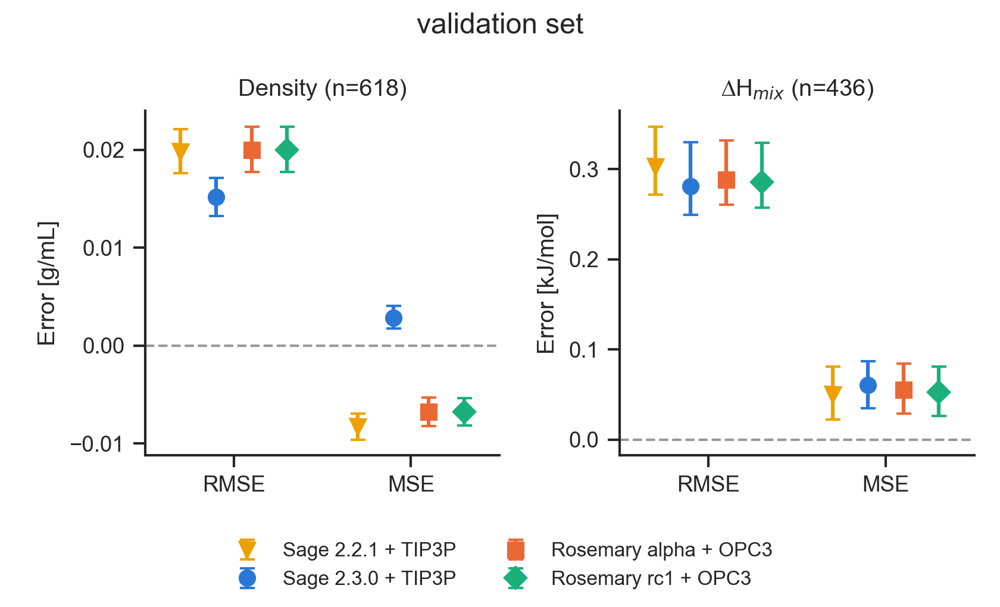

# Physical-property benchmarks: Sage 2.2.1, Sage 2.3.0, Rosemary alpha and OpenFF 3.0.0-rc1

Benchmarks of Sages 2.2.1 and 2.3.0 (TIP3P), and Rosemarys alpha0 and rc1.

Data for Sage is drawn from the Sage 2.3.0 benchmark repo and data.
Benchmarks were actually re-computed in the benchmarks directory of the Sage 2.3.0
repo on Iris, but copied into this new directory for easy transmission.
Scripts therefore have largely been copied and modified lightly.


## Results

Root-mean-square, mean signed (calc − expt) and mean unsigned errors of the replicate means
(`data/summary-statistics.csv`):

| Tier | Property | n | Sage 2.2.1 + TIP3P RMSE (MSE) | Sage 2.3.0 + TIP3P RMSE (MSE) | Rosemary alpha + OPC3 RMSE (MSE) | Rosemary rc1 + OPC3 RMSE (MSE) |
|---|---|---|---|---|---|---|
| training | density / g mL⁻¹ | 594 | 0.0180 (−0.0069) | 0.0147 (+0.0040) | 0.0176 (−0.0032) | 0.0176 (−0.0032) |
| training | ΔH<sub>mix</sub> / kJ mol⁻¹ | 561 | 0.466 (+0.126) | 0.439 (+0.130) | 0.438 (+0.119) | 0.440 (+0.118) |
| validation | density / g mL⁻¹ | 618 | 0.0198 (−0.0083) | 0.0152 (+0.0028) | 0.0200 (−0.0068) | 0.0200 (−0.0068) |
| validation | ΔH<sub>mix</sub> / kJ mol⁻¹ | 436 | 0.303 (+0.050) | 0.281 (+0.060) | 0.288 (+0.055) | 0.286 (+0.052) |


Headline figures for all four force fields (`pixi run headline`, 95% bootstrap CIs, seeded) are in
`analysis/images/headline/`:
- `combined-{training,validation,all}.png`: RMSE and MSE, density and ΔH<sub>mix</sub> side by side.
- `{density,dhmix}-{training,validation,all}-stats.png`: RMSE, MUE, MSE, ρ and R².
- `scatter-{training,validation,all}.png`: calculated vs experiment for each force field.

The numbers are in `analysis/output/headline/headline-stats.csv`.



The per-chemistry breakdown (checkmol functional groups and Sage 2.3.0 parameter IDs, with
per-group bootstrapped statistics) is in `analysis/`. It includes one figure per group with all
four force fields, density on the left and ΔH<sub>mix</sub> on the right
(`analysis/images/compare-rosemary/combined-{all,validation}/`), plus the detailed
per-group and per-property plots comparing Rosemary rc1 + OPC3 with Sage 2.3.0 + TIP3P.


## Layout

```
forcefields/        offxml files actually loaded by the benchmarks (constrained + unconstrained)
datasets/           Evaluator PhysicalPropertyDataSet JSON (+ CSV view): training-set, validation-set
data/
  results/<tier>/all/<ff>.csv              one row per property per replicate  (primary data)
  results/<tier>/summary/<ff>.csv          replicate mean (value) and sample SD (uncertainty)
  results/<tier>/replicates/rep-N/<ff>.csv the `all` table split by replicate
  collated/<tier>/                         all four force fields in one table (collate-all-results.py)
  summary-statistics.csv                   overall RMSE / MSE / MUE
benchmark/          drivers, request options, check / gather / collate scripts, stored-data subsetter
analysis/           headline + chemistry breakdown: scripts, precomputed labels, archived inputs/outputs/images
```

### Columns

`data/results/<tier>/all/<ff>.csv`: (unnamed row index), `id` (property ID in the dataset),
`index` (position in the dataset), `type` (`Density` | `EnthalpyOfMixing`), `substance`,
`smiles_1`, `smiles_2`, `forcefield`, `replicate` (1–3), `value`, `uncertainty` (Evaluator
statistical uncertainty of that replicate), `reference_value`, `reference_uncertainty`
(experiment). Units: g/mL (density), kJ/mol (enthalpy of mixing).

`summary/<ff>.csv`: same keys. `value` is the replicate mean, `uncertainty` is the sample
standard deviation over replicates, and `n_replicates` is 3.

## Usage

```bash
pixi install                 # analysis environment (osx-arm64, linux-64)
pixi run headline            # overall stats with bootstrap CIs + headline figures (all four FFs)
pixi run breakdown           # rerun the rc1 + OPC3 vs Sage 2.3.0 + TIP3P breakdown in place (or: pixi run breakdown stats)
```


### Benchmarks

The benchmarks use Evaluator's `PreequilibratedSimulationLayer`. Each property starts from a
pre-equilibrated box looked up in an Evaluator `LocalFileStorage`.

